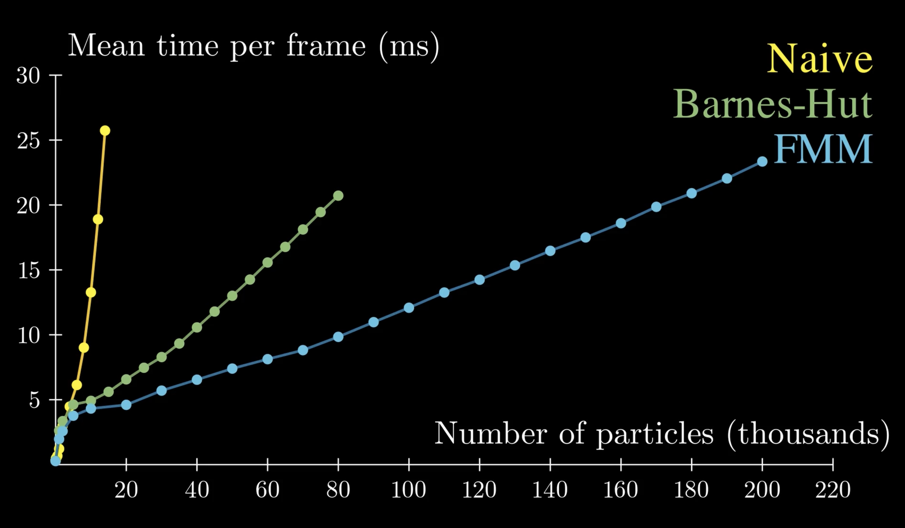
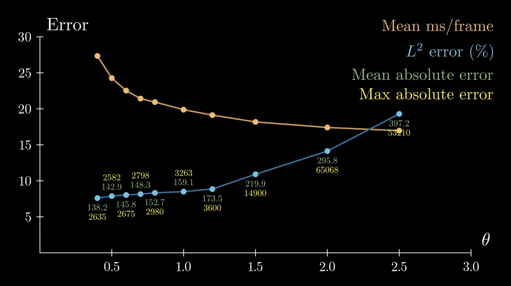
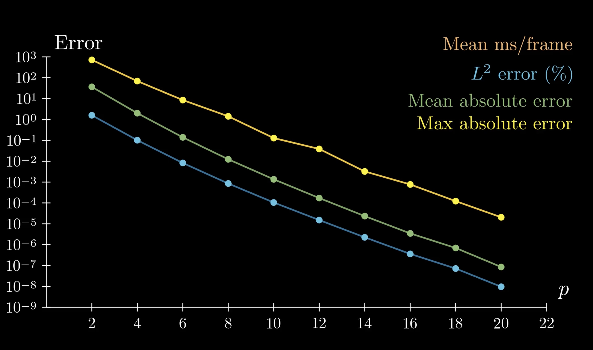

# 2D Fast Multipole Method


This is an implementation of the 2D Fast Multipole Method (FMM) in C++ and rendered in real time with SFML, using Velocity Verlet integration. FMM, invented by Greengard and Rokhlin, is an algorithm that solves the N-body problem in `O(N)` to a desired precision, a significant improvement over more commonly seen methods like Barnes-Hut, which is `O(NlogN)` with unbounded error, or naive calculation which is `O(N²)`. I created a 2-part video series to explain this algorithm, which you can watch here:

- [The mathematics](https://youtu.be/FhMftauQZqU)

This motivates each part of the algorithm from scratch, so only complex numbers + Taylor series are needed as prerequisites.

- [Implementation and testing](https://youtu.be/uOahsDhVZaE)

This goes through the structure of my code as well as optimizations I made. In the end I present performance tests on speed and accuracy when varying different parameters (e.g. box capacity, expansion order, particle distribution) as well as comparisons against the naive method and Barnes-Hut, from which the advantages of FMM become extremely apparent.

## How FMM works

Each time step:

1. **Tree build** using an adaptive quadtree to subdivide until each leaf node holds at most a constant number of bodies, `s`.
2.  **Upward pass** to form multipole expansions of order `p`. Each leaf calculates it directly from the particles, and then we move up the tree by using the multipole shift operator (M2M).
3. **Generate the interaction lists** for every node:
   - **U**: adjacent leaves, whose forces are summed directly (too close for our clever tricks)
   - **V**: well-separated boxes at the same level, whose multipole expansions can be flipped to local expansions (M2L)
   - **W and X**: neighbors of different sizes, which only appear in the adaptive tree and which we have to deal with in different ways
4. **Downward pass** to pass local expansions down to the leaf nodes, again shifting their centers (L2L).
5. **Evaluate forces** at each leaf with the local expansion at its bodies, added to some other operations we perform on certain interaction lists (U and W).

## Results

(Measured on MacBook Pro M4, 10 cores) (More detail about tests is provided in the second video)

FMM has several parameters which can be changed. First is `s`, which determines the maximum number of particles allowed in a leaf node. I tested varying values of `s` using two different particle distributions, arriving at the optimal value of `s = 60` which I used thereafter.

I was able to reach over 10¹² effective force calculations per second (140,000 particles, 60fps) with expansion order `p = 10`, yielding an error of about 10⁻⁶. When `p = 20`, this error decreases to around 10⁻¹⁰. Error is measured by `diagnostics.hpp` against exact naive calculation over a random sample of targets. The times below are taken over an average of 30 seconds (1800 frames), starting with 30,000 particles uniformly distributed in a square and 90,000 particles normally distributed around the center.

| N | Naive (ms/step) | Barnes–Hut (ms/step), `θ = 1` | FMM (ms/step), `p = 10` |
| --- | --- | --- | --- |
| 0 | 0.3335 | 0.3084 | 0.2733 |
| 1,000 |  1.2181| 2.6156 | 1.9673|
| 2,000 | 3.0139| 3.3530 | 2.5848 |
| 5,000 | -|4.6285 | 3.7668 |
| 10,000 | 13.2702 | 4.8142 | 4.3180 |
| 20,000 | -| 6.5678 | 4.6049  |
| 50,000 | -| 13.0064 | 7.3974 |
| 80,000 | -| 20.7186 | 9.8431 |
| 100,000 | -| -| 12.0837 |
| 140,000 | -| -| 16.4699 |
| 150,000 | -| -| 17.5005 |
| 200,000 | -| -| 23.3487 |



### Error
Moreover, the arguably more significant advantage of FMM is its tunable error. Barnes-Hut's error is unpredictable and significantly high, even at low values of `θ` (which also lead to very slow performance), while FMM has a guaranteed exponentially decreasing error bound.


Barnes-Hut


FMM

## Design notes

- **Node arena with 32-bit indices.** All tree nodes live in one preallocated array and refer to each other by `uint32_t` index instead of by pointer. There's no heap allocation per node, children are stored close together in memory, and each reference is half the size of a pointer.
- **In-place partitioning.** Tree construction sorts the bodies into quadrants in place, in the style of quicksort. Every node then owns a contiguous range of the body array, so no per-node child arrays are needed and leaf loops read memory sequentially.
- **Per-thread deferred updates.** Interaction lists are built in parallel with OpenMP. Writing straight into another node's lists from several threads would be a data race, so each thread records its updates in its own buffer, and the buffers are merged afterwards.
- **Fixed-size expansions.** Expansion coefficients are stored in fixed-size arrays (expansion order up to 30) to avoid heap allocation inside the hot loops.
- **Depth cap.** Subdivision stops at depth 20, where floating-point precision can no longer separate nearby bodies.

## Files

| File | Contents |
| --- | --- |
| `src/main.cpp` | Initial conditions, time integration, rendering |
| `src/adaptive_quadtree.hpp` | Base quadtree, node adjacency, breadth-first traversal |
| `src/fmm_tree.hpp` | FMM tree construction, U/V/W/X lists, upward and downward passes |
| `src/multipole_expansion.hpp` | Multipole expansions, their translation (M2M), and evaluation |
| `src/local_expansion.hpp` | Local expansions, conversion from multipoles (M2L), translation (L2L), and evaluation |
| `src/math_utils.hpp` | Shared series base class, binomial table, file input/output |
| `src/barnes_hut_tree.hpp` | Barnes–Hut implementation used as a comparison baseline |
| `src/diagnostics.hpp` | Exact force summation and error measurement |

## Building and running

### Requirements

- CMake 3.28 or newer
- A C++20 compiler with OpenMP
- CMake downloads and builds SFML automatically

Platform setup:

- **macOS:** install OpenMP with `brew install libomp`.
- **Linux:** install SFML's system dependencies:

  ```bash
  sudo apt-get install libxrandr-dev libxcursor-dev libxi-dev libudev-dev \
    libfreetype-dev libharfbuzz-dev libflac-dev libvorbis-dev \
    libgl1-mesa-dev libegl1-mesa-dev
  ```

- **Windows:** Visual Studio 2022 with the C++ workload; no extra installation is needed.

### Build

```bash
git clone https://github.com/keyframe41/Fast-Multipole-Method.git
cd Fast-Multipole-Method
cmake -S . -B build
cmake --build build --config Release
```

### Build and Run

Run the program from inside the `build` folder:

```bash
cd build
make
../bin/sim
```

Press **Esc** to quit.

To change the simulation, play around with the parameters stored in `main.cpp`.

## References

- L. Greengard and V. Rokhlin, "A fast algorithm for particle simulations," *Journal of Computational Physics* 73 (1987).
- J. Carrier, L. Greengard, and V. Rokhlin, "A fast adaptive multipole algorithm for particle simulations," *SIAM Journal on Scientific and Statistical Computing* 9 (1988).

## License

Code: see [LICENSE.md](LICENSE.md). Font: JetBrains Mono, under the SIL Open Font License ([assets/OFL.txt](assets/OFL.txt)).

Build setup based on SFML's [CMake project template](https://github.com/SFML/cmake-sfml-project).
